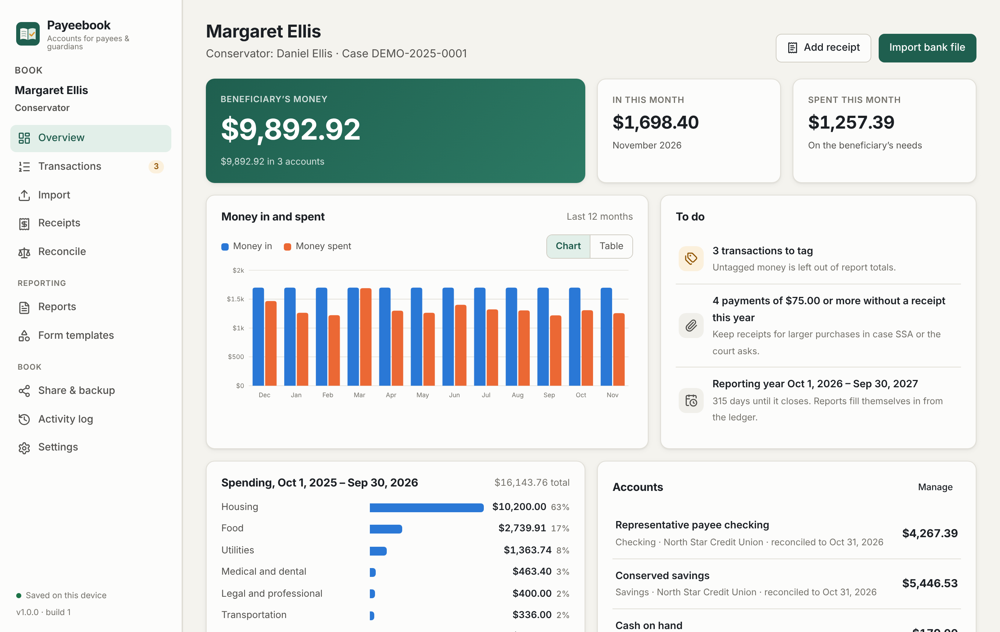
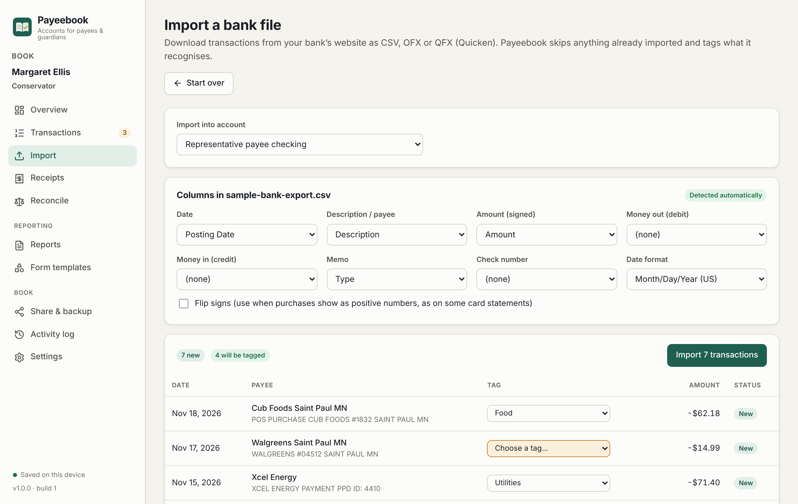
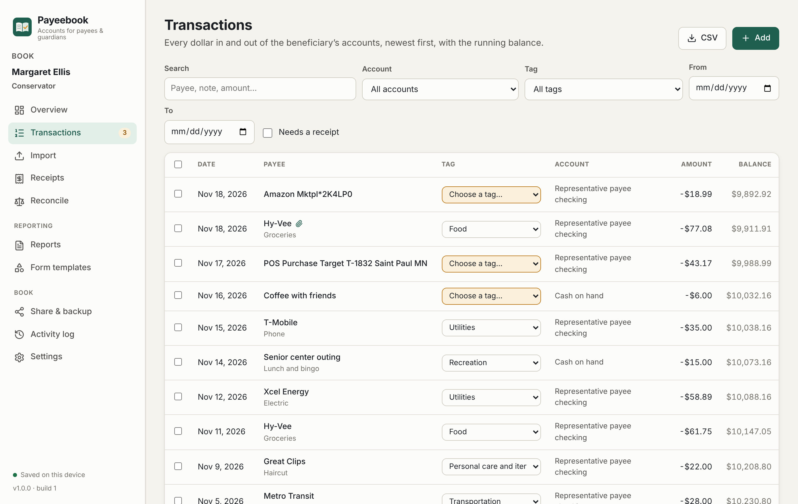
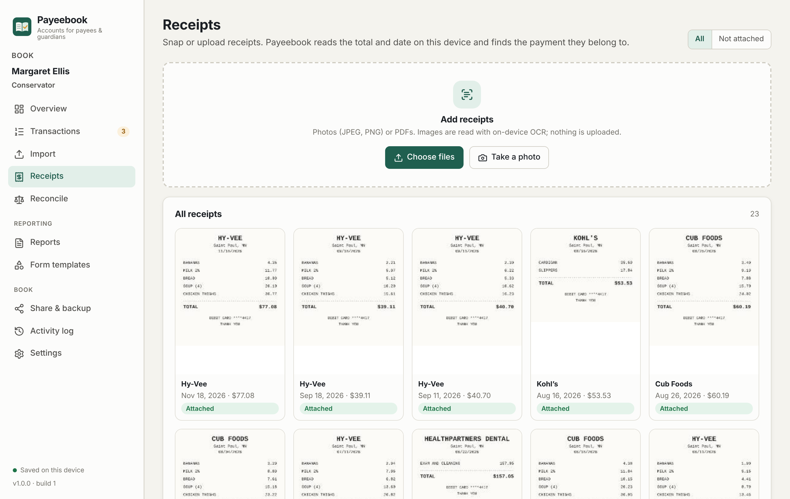
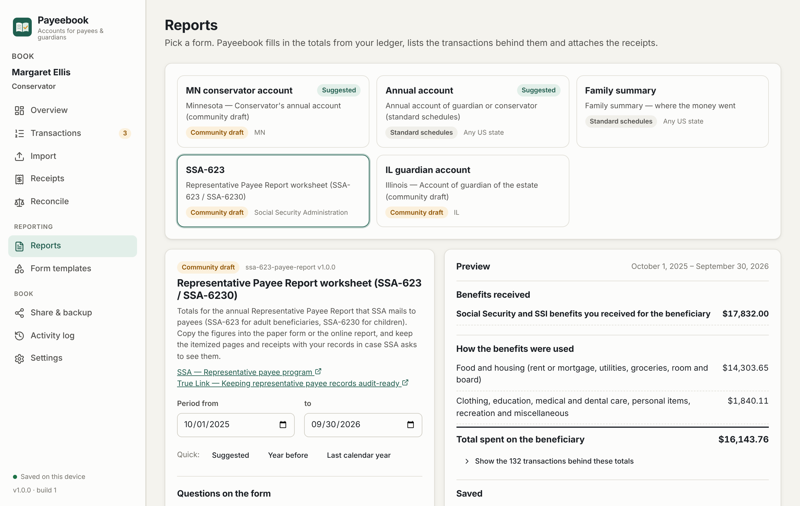
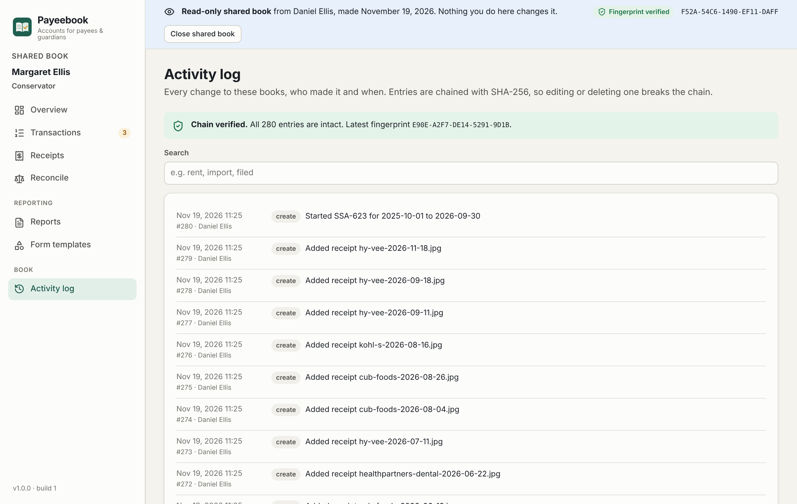
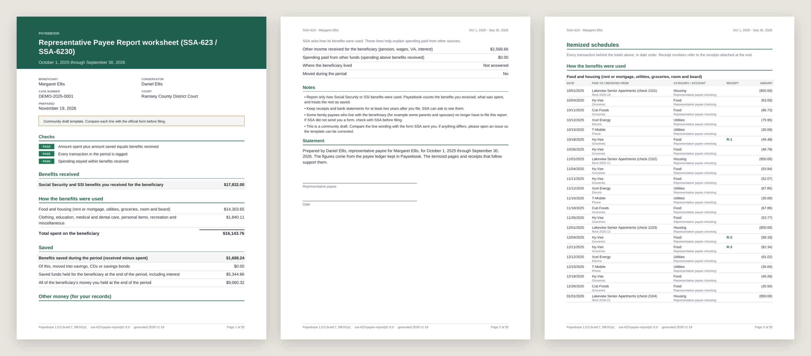
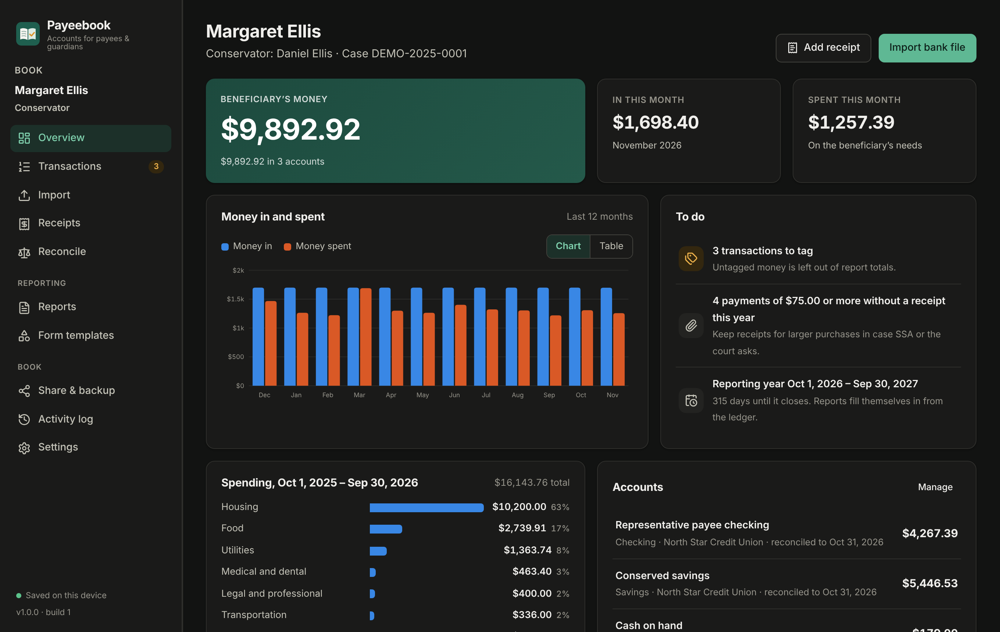
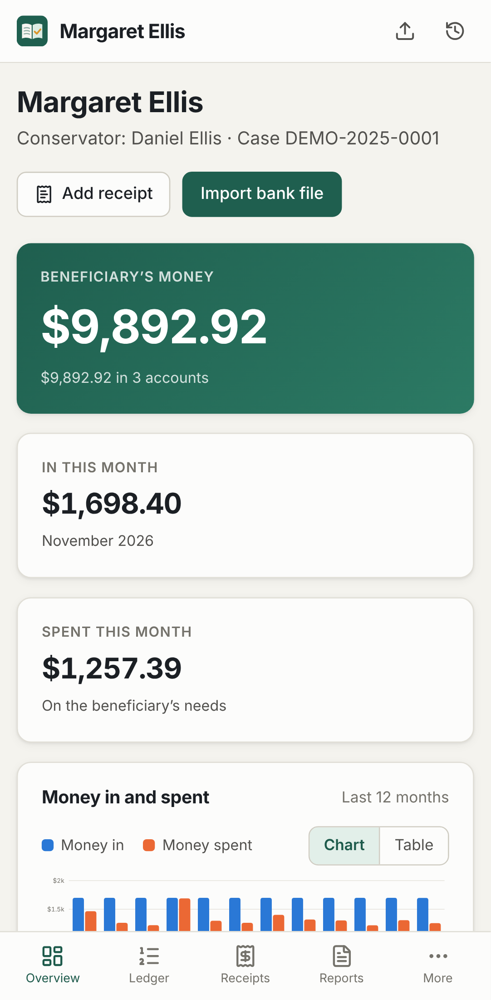
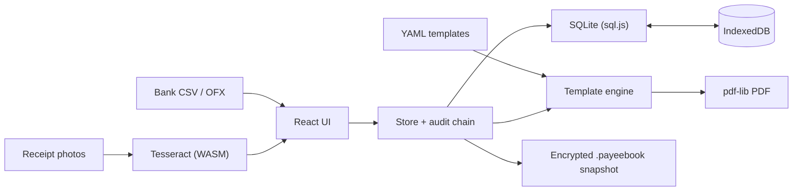

<div align="center">


# Payeebook

**Free, private accounts for family representative payees, guardians and conservators.**

Import the bank file or snap the receipt, tag each transaction once, and print
the SSA payee report or the court accounting when it is due.

[](https://github.com/lobojoel2003/Payeebook/actions/workflows/ci.yml)
[](https://github.com/lobojoel2003/Payeebook/releases/latest)
[](https://github.com/lobojoel2003/Payeebook/actions/workflows/release.yml)
[](https://github.com/lobojoel2003/Payeebook/actions/workflows/codeql.yml)
[](LICENSE)
[](templates/LICENSE)

[**Download**](https://github.com/lobojoel2003/Payeebook/releases/latest) ·
[**Open the web app**](https://lobojoel2003.github.io/Payeebook/) ·
[Add your state's form](templates/README.md) ·
[Changelog](CHANGELOG.md)



</div>

## Why Payeebook

Millions of people have their money managed by someone else, usually a family
member: a Social Security **representative payee**, a court-appointed
**guardian**, or a **conservator**.

- Payees must keep records of how every benefit dollar was spent or saved and
  show them if SSA asks ([SSA's payee page](https://www.ssa.gov/payee/index.htm)).
  [True Link](https://www.truelinkfinancial.com/blog/tips-keep-records-audit-ready-rep-payee)
  advises keeping them at least two years after the annual report, with monthly
  reconciliation.
- Guardians and conservators must file an annual accounting with the probate
  court, in a format that differs by state and county. Courts see enough errors
  that some built their own tools, like Illinois' 22nd Circuit
  [Guardianship Accounting Program](https://www.22ndcircuitil.gov/guardianship-accounting-program/)
  and Minnesota's MyMNConservator.

Most families do this from shoeboxes of receipts. Paid apps target professional
fiduciaries, court tools cover a single county, and nothing free and open covers
both payees and guardians or produces state court formats. Payeebook does.

## What it does

|                                                                                                                                                                                                                                                                      |                                                                                                                          |
| -------------------------------------------------------------------------------------------------------------------------------------------------------------------------------------------------------------------------------------------------------------------- | ------------------------------------------------------------------------------------------------------------------------ |
| **Import, don't type.** CSV from any bank (columns detected automatically) and OFX/QFX. Overlapping statements never create duplicates.                                                                                                                              |                          |
| **Tag it once.** Every transaction gets one tag: housing, food, medical, saved… Tag a payee once and Payeebook tags it for you from then on. Mixed purchases can be split.                                                                                           |                     |
| **Snap receipts.** On-device OCR reads the total and date, then finds the payment it belongs to. Receipts are attached to the report PDF as numbered exhibits.                                                                                                       |                                                    |
| **Reports fill themselves in.** Pick the SSA-623 worksheet or a court accounting; Payeebook computes every line from the ledger, checks that the books balance and produces a PDF with itemized schedules and receipts. It can also fill a court's own fillable PDF. |                            |
| **Open books for the family.** Send a sibling or attorney an encrypted, read-only copy. A fingerprint you read to each other proves it was not altered, and a hash-chained activity log shows every change.                                                          |  |

<div align="center">

<br><sub>A generated report: totals and checks, then every transaction behind them, then the receipts.</sub>
</div>

### Also

- **Running balance of all the beneficiary's money**, across checking, savings,
  cash and money moved into CDs or bonds.
- **Monthly reconciliation** against the bank statement, with hints when it is off.
- **Filing locks the period**, so the books keep matching what you submitted.
  Reopening is allowed and recorded.
- **Backups** as a single file, printable ledger PDF and CSV export.
- **Works offline** as an installable web app, and as a desktop app for Windows,
  macOS and Linux. Light and dark themes, phone layout.

<div align="center">

&nbsp;

</div>

## Private by design

- **Your data stays on your device.** Books are stored in your browser (IndexedDB)
  or the desktop app's data folder. There is no account, no server, no analytics,
  and nothing is loaded from a CDN.
- **Receipts are read on the device** by Tesseract compiled to WebAssembly.
- **Sharing is your choice**: a file you send yourself, encrypted with AES-256
  and a passphrase you choose.

See [SECURITY.md](SECURITY.md) for details.

## Get started

### Use it in the browser

Open **<https://lobojoel2003.github.io/Payeebook/>**, choose **Explore a demo**
to look around, or **Start a book**. Use your browser's _Install_ button to keep
it as an app that works offline.

### Install the desktop app

Download the installer for your system from the
[latest release](https://github.com/lobojoel2003/Payeebook/releases/latest):

| System        | File                                                                        |
| ------------- | --------------------------------------------------------------------------- |
| Windows 10/11 | `Payeebook_<version>_x64-setup.exe` or `.msi`                               |
| macOS 11+     | `Payeebook_<version>_universal.dmg` (right-click → **Open** the first time) |
| Linux         | `.AppImage`, `.deb` or `.rpm`                                               |

Every release lists SHA-256 checksums in `SHA256SUMS.txt`.

### Run from source

```bash
git clone https://github.com/lobojoel2003/Payeebook.git
cd Payeebook
npm ci
npm run dev
```

Then open <http://localhost:5173>. For the desktop shell, install the
[Tauri prerequisites](https://v2.tauri.app/start/prerequisites/) and run
`npm run desktop:dev`.

## How a year with Payeebook goes

1. **Set up** the book: who the money belongs to, your role, the court or agency,
   and the accounts.
2. **Each month**, download the bank's CSV or OFX file and import it. Tag what
   Payeebook did not recognise. Snap receipts for larger purchases.
3. **Reconcile** against the statement. A zero difference means nothing is missing.
4. **At report time**, open **Reports**, pick the form, answer its questions, fix
   anything the checks flag, and download the PDF. Copy the totals into SSA's
   form or file the court account.
5. **Mark it filed**. The period locks. Keep receipts and statements at least two
   years.
6. **Share a read-only copy** with family whenever they ask.

## Form templates

Each report is a YAML file in [`templates/`](templates/). A volunteer can add
their state's court accounting form in an afternoon, without writing code:

```yaml
- id: benefits
  label: 'Social Security, SSI and VA benefits'
  sum: { court: [receipts.benefits] }
- id: closing
  label: 'Balance at the end of the period'
  value: summary.opening + receipts.total - disbursements.total
```

| Template                                                       | Status          |
| -------------------------------------------------------------- | --------------- |
| SSA-623 / SSA-6230 Representative Payee Report worksheet       | Community draft |
| Annual account of guardian or conservator (standard schedules) | Generic         |
| Illinois — account of guardian of the estate                   | Community draft |
| Minnesota — conservator's annual account                       | Community draft |
| Family summary — where the money went                          | Generic         |

_Community draft_ templates were written from public descriptions of the forms
and need someone with the current official form to check them. Please help:
read the [template guide](templates/README.md) or
[request a form](https://github.com/lobojoel2003/Payeebook/issues/new?template=form_template.yml).

## How it is built



| Area    | Technology                                                                        |
| ------- | --------------------------------------------------------------------------------- |
| App     | React 19, TypeScript, Vite, PWA (Workbox)                                         |
| Storage | SQLite via sql.js, persisted to IndexedDB                                         |
| Import  | Papa Parse (CSV), own OFX 1.x/2.x parser                                          |
| OCR     | Tesseract.js, assets bundled with the app                                         |
| PDF     | pdf-lib (reports, ledger, filling official AcroForms)                             |
| Desktop | Tauri 2 (Rust)                                                                    |
| Tests   | Vitest (150+ unit tests), Playwright (end-to-end, including real OCR), cargo test |

More in [docs/ARCHITECTURE.md](docs/ARCHITECTURE.md).

```text
src/core       money, dates, CSV/OFX import, payee rules, receipt parsing, template engine
src/db         SQLite schema, Store (all writes + audit log), persistence, sharing, demo data
src/pdf        report, ledger and AcroForm PDF generation
src/ocr        image preparation and the Tesseract worker
src/ui         pages and components
templates/     YAML form templates (MIT) and their JSON schema
src-tauri/     desktop shell
e2e/           Playwright tests
```

## Development

| Command                                 | What it does                                         |
| --------------------------------------- | ---------------------------------------------------- |
| `npm run dev`                           | Development server on port 5173                      |
| `npm run build`                         | Type check and production build into `dist/`         |
| `npm test`                              | Unit tests; `npm run test:coverage` for coverage     |
| `npm run test:e2e`                      | Playwright browser tests (run `npm run build` first) |
| `npm run lint` / `npm run format`       | ESLint / Prettier                                    |
| `npm run templates:validate`            | Validate every form template against sample data     |
| `npm run desktop:dev` / `desktop:build` | Run or package the desktop app                       |
| `npm run screenshots`                   | Regenerate the images in this README                 |

## Versions, builds and releases

Payeebook follows [Semantic Versioning](https://semver.org/). Every build is
stamped with its **version**, **build number** (the CI run) and **commit**,
shown under _Settings → About_ and printed in the footer of every PDF, so a
filed report can be traced to the exact code that produced it.

- **CI** runs lint, formatting, type checks, unit tests with coverage, template
  validation, the production build, Playwright end-to-end tests and Rust checks
  on every push and pull request.
- **Releases** are cut by pushing a `vX.Y.Z` tag (`npm version minor && git push
--follow-tags`). The release workflow verifies the version everywhere, builds
  the web app and installers for Windows, macOS and Linux, attaches the template
  library and SHA-256 checksums, and publishes the GitHub Release with notes from
  the [changelog](CHANGELOG.md).
- **GitHub Pages** redeploys the web app on every push to `main`.

Details in [docs/RELEASING.md](docs/RELEASING.md).

## Contributing

Templates for more states and counties are the most useful contribution, and
checking the drafts against the real forms is next. Code contributions are
welcome too. See [CONTRIBUTING.md](CONTRIBUTING.md). Please never post real
financial data in issues.

## Disclaimer

Payeebook is not legal, tax or financial advice, and it is not affiliated with
the Social Security Administration, the Department of Veterans Affairs or any
court. Check every report against the official form and your court's rules
before filing.

## Licence

The app is licensed under the [GNU General Public License v3.0 or later](LICENSE).
The form templates in [`templates/`](templates/) are licensed under the
[MIT licence](templates/LICENSE) so courts, legal aid groups and other tools can
reuse them.
