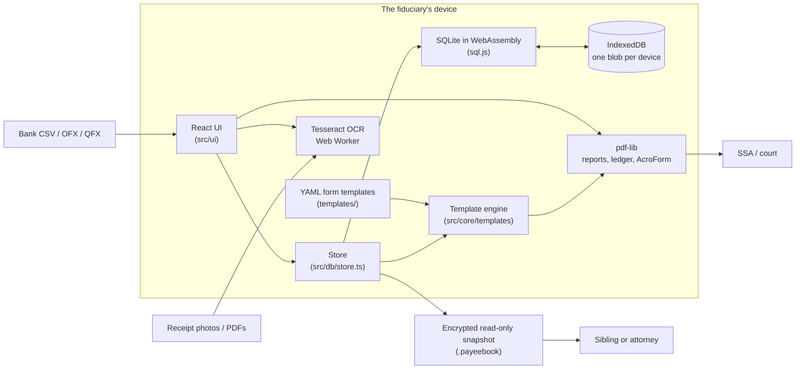

# Architecture

Payeebook is a local-first web app. The same build runs in a browser tab, as an
installed PWA, and inside the Tauri desktop shell. There is no server.

## Layers

| Layer                  | Path                  | Notes                                                                                                                                                                                                                    |
| ---------------------- | --------------------- | ------------------------------------------------------------------------------------------------------------------------------------------------------------------------------------------------------------------------ |
| Core (pure TypeScript) | `src/core`            | Money in integer cents, calendar dates without time zones, CSV and OFX parsers, payee normalisation and rules, receipt text parsing, SHA-256, the template expression language and evaluator. No DOM, fully unit tested. |
| Data                   | `src/db`              | SQLite schema and migrations, the `Store` repository (every write is a transaction and appends to the hash-chained audit log), persistence to IndexedDB, snapshots and backups, demo data.                               |
| PDF                    | `src/pdf`             | Report and ledger rendering with pdf-lib, WinAnsi-safe text, AcroForm filling of official forms. Loaded on demand.                                                                                                       |
| OCR                    | `src/ocr`             | Image normalisation (downscale, JPEG, thumbnail) and a Tesseract worker using assets vendored into `public/vendor` at build time.                                                                                        |
| UI                     | `src/ui`, `src/state` | React 19, hash routing (works on any static host and in Tauri), a small context that re-runs synchronous SQLite queries after each change.                                                                               |
| Desktop                | `src-tauri`           | Tauri 2 shell. Adds a native save dialog (`save_file` command with a raw-bytes IPC body) and opens links in the system browser.                                                                                          |

## Data model

- `books` – one per beneficiary; fiduciary role, court/agency details, reporting month.
- `accounts` – checking, savings, cash, prepaid…, each with an opening balance.
- `transactions` – signed integer cents (positive is money in). `import_key` makes imports idempotent.
- `splits` – optional parts of a transaction with their own tags. The `tx_lines` view yields one row per ledger line.
- `receipts` – the image or PDF bytes, thumbnail and OCR results, optionally linked to a transaction.
- `rules` – "payee contains X → tag Y", applied on import.
- `reconciliations`, `reports` (draft / filed / reopened), `user_templates`, `import_profiles`.
- `audit_log` – append-only; `hash = SHA-256(prev_hash + entry)` per book.

**Beneficiary funds** = the sum of account balances + money tagged _Saved_ that
left the tracked accounts (CDs, savings bonds, an untracked savings account).
Transfers between two tracked accounts are tagged _Transfer_ on both sides and
net to zero.

## Templates

A template is YAML validated against `templates/schema.json` and by
`src/core/templates/validate.ts`, which also checks every formula reference.
Lines are either `sum` (filter tagged ledger lines by category, kind, SSA bucket
or court group), `value` (a formula), `input` (a question answered at report
time) or `text`. `checks` are formulas that must be true. See
[templates/README.md](../templates/README.md).

## Why these choices

- **sql.js + IndexedDB** instead of OPFS/wa-sqlite: works in every browser and
  in Tauri's webviews without cross-origin isolation headers, and a family's
  books (thousands of rows plus receipts) fit comfortably in memory.
- **Synchronous queries**: SQLite runs in the page, so screens read data
  directly and re-render after each committed write. No cache invalidation.
- **Hash routing and a relative base path**: the same `dist/` folder works on
  GitHub Pages, any static host, `file://`-like webviews and the desktop app.
- **No CDN at runtime**: SQLite, the OCR engine and its English model ship with
  the app, so it works offline and nothing about a receipt leaves the device.
